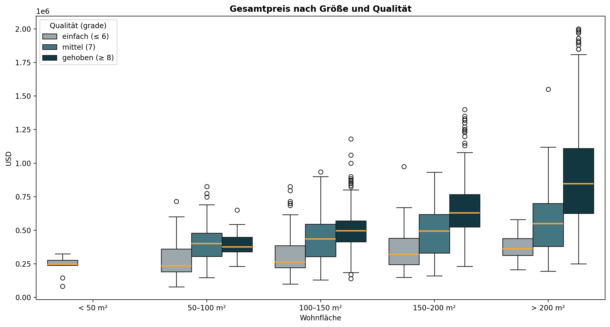

# Wo, was und wann? Hauskauf in Seattle mit Daten entscheiden

Explorative Datenanalyse (EDA) von rund **21.600 Hausverkäufen in King County (Seattle, USA)** zwischen Mai 2014 und Mai 2015. Die Analyse beantwortet für eine fiktive Kundin, Nicole Johnson, drei Fragen: **Wo** soll sie suchen, **was** bekommt sie für ihr Budget, und **wann** sollte sie kaufen?

Nicole sucht ein Haus, das **zentral und belebt** liegt und in der **mittleren Preisklasse** ist, mit 2 bis 3 Zimmern und 1 bis 2 Bädern.

> **Schnellzugriff:** [Notebook mit der Analyse](02_eda.ipynb) · [Präsentation (PDF)](presentation/Hauskauf_Seattle.pdf) · [Notebook in nbviewer](https://nbviewer.org/github/Litlebuda1/seattle-housing-eda/blob/main/02_eda.ipynb)

## Fragestellung und Hypothesen

| Frage | Hypothese | Ergebnis |
| --- | --- | --- |
| **Wo?** | In einem gewissen Abstand zu den belebten Vierteln sind Häuser bei ähnlicher Größe günstiger. | Teilweise bestätigt |
| **Was?** | Kleinere Häuser sind in zentraler Lage günstiger als große. | Teilweise bestätigt |
| **Wann?** | Die Preise im Zentrum steigen, ein schneller Kauf spart Geld. | Nicht bestätigt |

## Zentrale Ergebnisse

- **Die Ausstattung treibt den Preis stärker als die Lage oder die Größe.** Bei 150 bis 200 m² liegt der Medianpreis bei ca. 320.000 USD (einfache Ausstattung), 493.000 USD (mittel) und 630.000 USD (gehoben). Die drei Qualitätsgruppen liegen dabei ähnlich weit vom Zentrum entfernt.
- **Weiter draußen gibt es mehr Fläche, aber kaum einen niedrigeren Gesamtpreis.** Der Preis pro m² sinkt von ca. 4.080 USD (0 bis 1 km vom nächsten belebten Viertel) auf ca. 3.160 USD (3 bis 5 km). Die Häuser und Grundstücke außerhalb sind aber größer, deshalb hängt der Gesamtpreis kaum mit der Entfernung zusammen (Spearman −0,08).
- **Kleine Häuser sind günstiger, pro m² aber teurer.** Der Medianpreis steigt von ca. 322.000 USD (50 bis 100 m²) auf 739.000 USD (über 200 m²), der Preis pro m² sinkt dabei von ca. 3.870 auf 2.990 USD.
- **Kein Grund zur Eile.** Über die 13 Monate bleiben die Medianpreise weitgehend stabil. Nur im mittleren Segment steigt der Preis im Mai 2015 (+21 % gegenüber Mai 2014), bei kleinen Fallzahlen.



## Empfehlung für die Kundin

1. **Gebiet:** Rund um Capitol Hill, Fremont und Ballard suchen (bis ca. 3 km).
2. **Budget:** Lieber bei der Ausstattung als bei der Lage Abstriche machen. Das bringt in gleicher Lage mehr Wohnfläche fürs gleiche Geld.
3. **Kompromiss:** In 3 bis 5 km Entfernung gibt es vor allem mehr Platz, aber nicht automatisch einen niedrigeren Gesamtpreis.
4. **Zeitpunkt:** Die Daten liefern kein Argument, den Kauf zu beschleunigen oder zu verschieben.
5. **Zustand:** Er hängt kaum mit dem Preis zusammen, auf einen guten Zustand muss sie nicht verzichten.

## Vorgehen

1. **Daten laden:** SQL-Join zweier Tabellen aus einer PostgreSQL-Datenbank, Export als CSV ([01_daten_laden.ipynb](01_daten_laden.ipynb)).
2. **Bereinigung:** fehlende Werte begründet ersetzen (`waterfront`, `view`, `sqft_basement`, `yr_renovated`), falsch skalierte Renovierungsjahre korrigieren, Ausreißer prüfen, Flächen in m² umrechnen.
3. **„Zentral“ messbar machen:** Luftlinie (Haversine) jedes Hauses zum nächsten von sieben belebten Vierteln, eingeteilt in Entfernungsringe.
4. **„Mittlere Preisklasse“ aus den Daten ableiten:** mittlere 50 % der Verkaufspreise (25 %- bis 75 %-Quantil).
5. **Analyse:** Spearman-Korrelationen, Vergleiche nach Größen- und Qualitätsgruppen, Preisverlauf über die Monate, Vergleich Mai 2014 gegen Mai 2015 und Auswertung von Wiederverkäufen.
6. **Kommunikation:** Präsentation für ein nicht-technisches Publikum.

Die Grenzen der Analyse (nur ein Jahr Daten, kleine Gruppen, keine Angabe zur Art der Immobilie, Korrelation statt Kausalität) sind am Ende des Notebooks beschrieben.

## Tools

Python · pandas · NumPy · seaborn · Matplotlib · Plotly · SQL (PostgreSQL, SQLAlchemy, psycopg2) · Jupyter · uv

## Projektstruktur

| Datei / Ordner | Inhalt |
| --- | --- |
| [01_daten_laden.ipynb](01_daten_laden.ipynb) | Verbindung zur Datenbank und Export der Daten als CSV |
| [02_eda.ipynb](02_eda.ipynb) | Die vollständige Analyse mit Bereinigung, Hypothesen und Empfehlung |
| [figures/](figures/) | Exportierte Abbildungen sowie interaktive Karten als HTML (zum Ansehen herunterladen und im Browser öffnen) |
| [presentation/](presentation/) | Präsentation als PowerPoint und PDF |
| [column_names.md](column_names.md) | Beschreibung der Spalten des Datensatzes |

## Reproduzieren

Voraussetzungen: [uv](https://docs.astral.sh/uv/) und Zugang zur Kursdatenbank. Alternativ lässt sich der öffentliche [Kaggle-Datensatz](https://www.kaggle.com/datasets/harlfoxem/housesalesprediction) verwenden, er hat dieselbe Struktur, die Spaltennamen können aber leicht abweichen.

```bash
git clone git@github.com:Litlebuda1/seattle-housing-eda.git
cd seattle-housing-eda
uv sync
cp .env.example .env   # Zugangsdaten der Datenbank eintragen
```

Danach zuerst `01_daten_laden.ipynb` ausführen (erzeugt `data/eda.csv`), dann `02_eda.ipynb`. Die Daten selbst und die `.env` liegen nicht im Repository.

## Hintergrund

Entstanden als EDA-Projekt im Data-Science-Bootcamp von [neue fische](https://www.neuefische.de/). Die Projektvorlage steht unter der [MIT-Lizenz](LICENSE).
